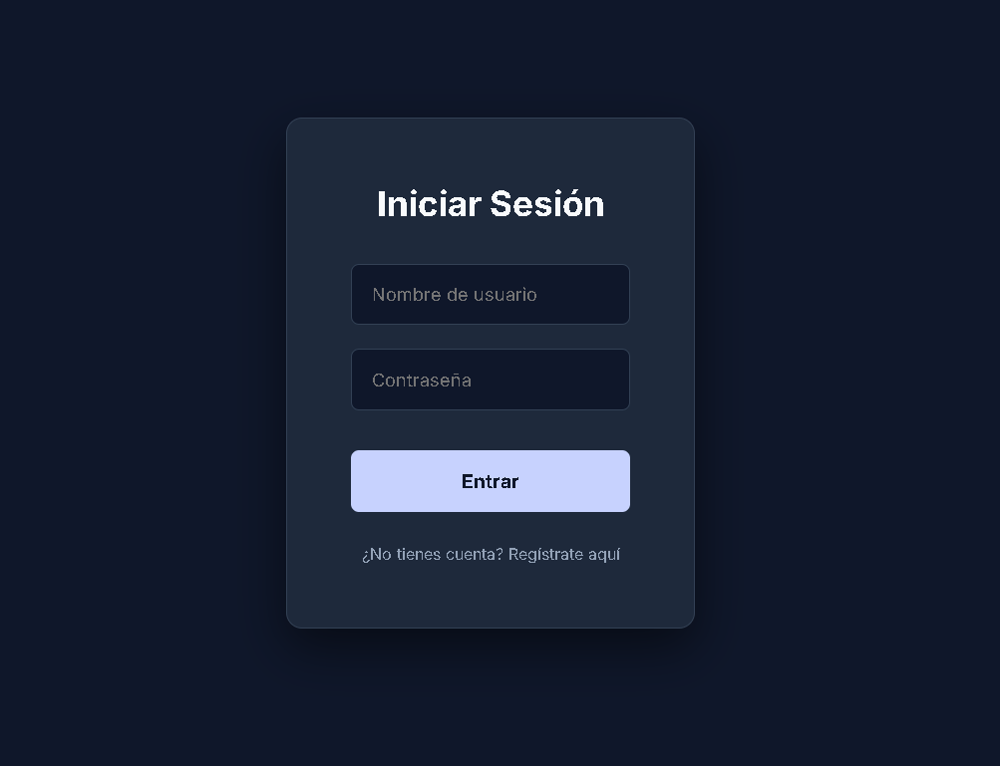
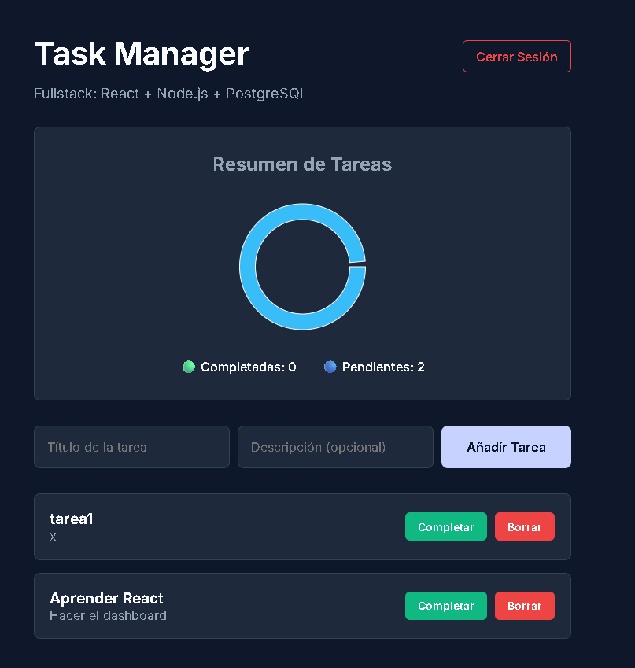

# Fullstack Task Manager (React + Node.js + PostgreSQL)

A complete Task Management application with a modern dark-mode UI, user authentication, and data visualization.

## 📸 Screenshots

### Login Screen


### Dashboard & Analytics


## 🚀 Tech Stack

**Frontend:**
- React (Vite)
- Recharts (Data visualization)
- Vanilla CSS (Dark Mode, responsive design)

**Backend:**
- Node.js & Express
- PostgreSQL (Relational Database)
- JWT (JSON Web Tokens) for authentication
- Bcrypt (Password hashing)

## ⚙️ Architecture & Features
- **Monorepo Structure:** Separated into `frontend` and `backend` folders for clean architecture.
- **MVC Pattern:** Backend logic is separated into Routes, Controllers, and Middlewares.
- **Security:** Protected API routes using JWT. User passwords are encrypted before being stored in the database.
- **CRUD Operations:** Users can create, read, update (toggle status), and delete tasks.
- **Analytics:** A dynamic pie chart showing the ratio of completed vs. pending tasks.

## 🛠️ How to Run Locally

### 1. Database Setup (PostgreSQL)
- Create a database named `task_manager_db`.
- Run the SQL script located in the `/database` folder (or create the `usuarios` and `tareas` tables manually).

### 2. Backend Setup
- Navigate to the backend folder: `cd backend`
- Install dependencies: `npm install`
- Create a `.env` file in the `backend` folder with the following variables:
  ```env
  PORT=3000
  DB_USER=your_postgres_user
  DB_PASSWORD=your_postgres_password
  DB_HOST=localhost
  DB_PORT=5432
  DB_NAME=task_manager_db
  JWT_SECRET=your_super_secret_key